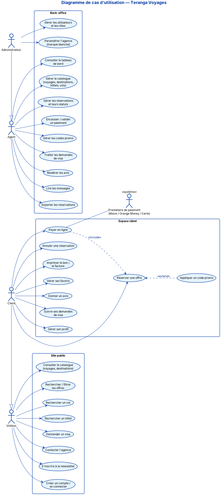
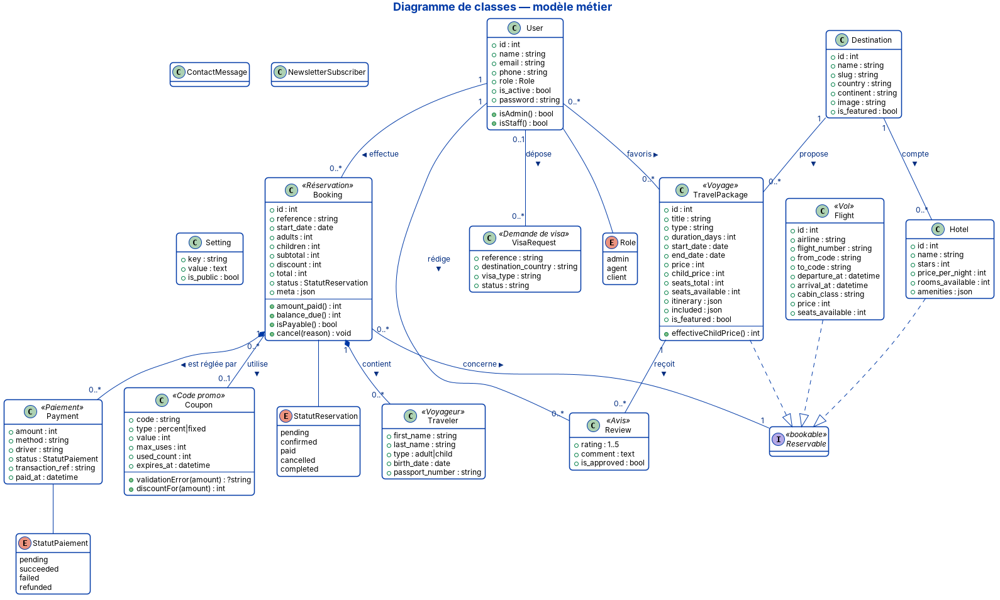
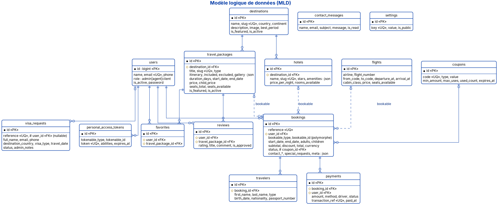
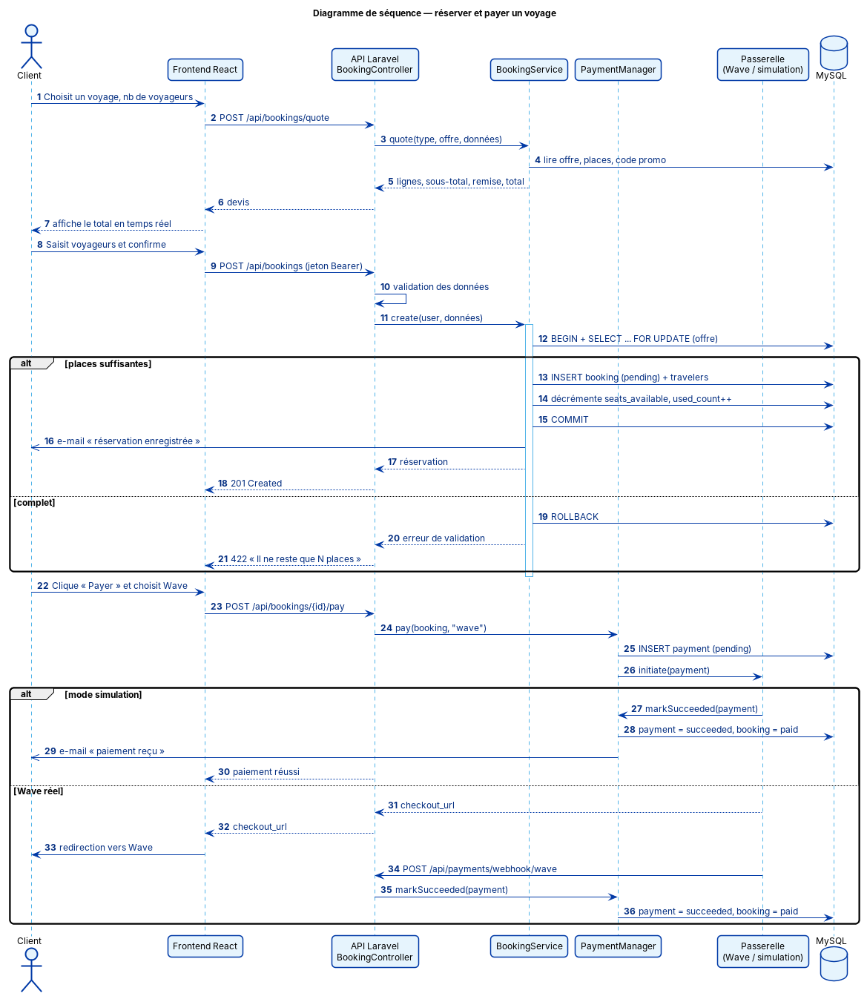
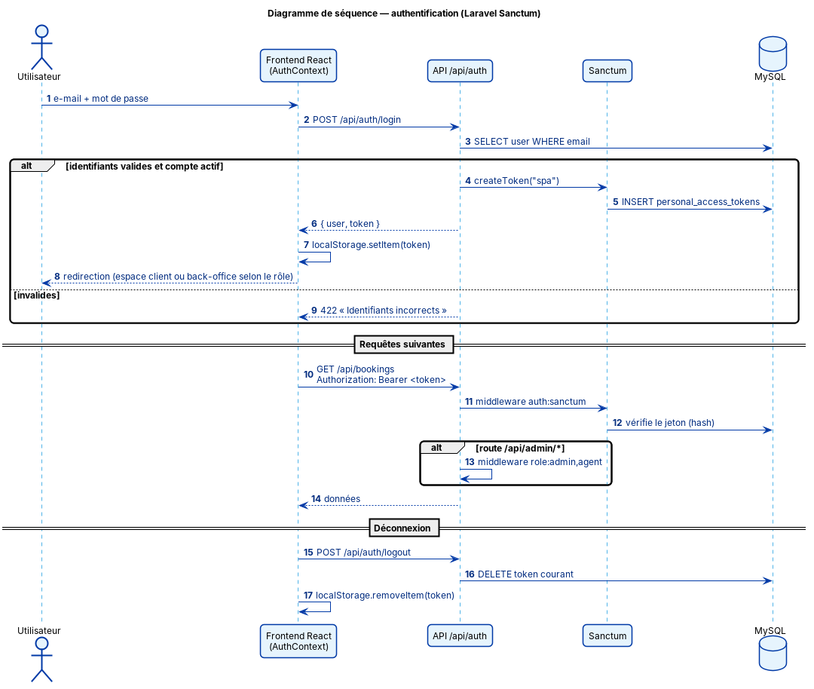
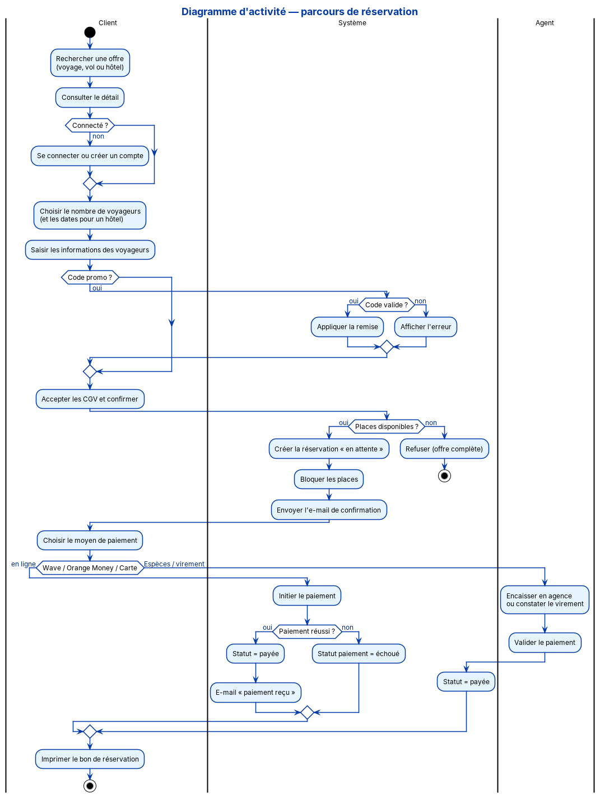
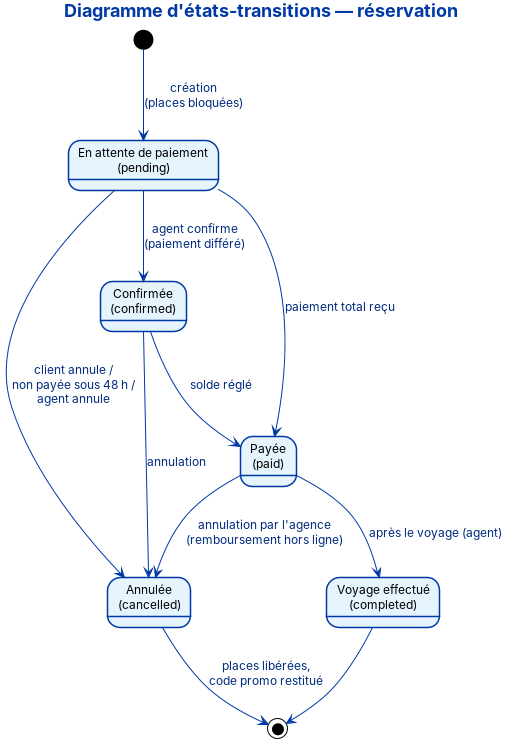
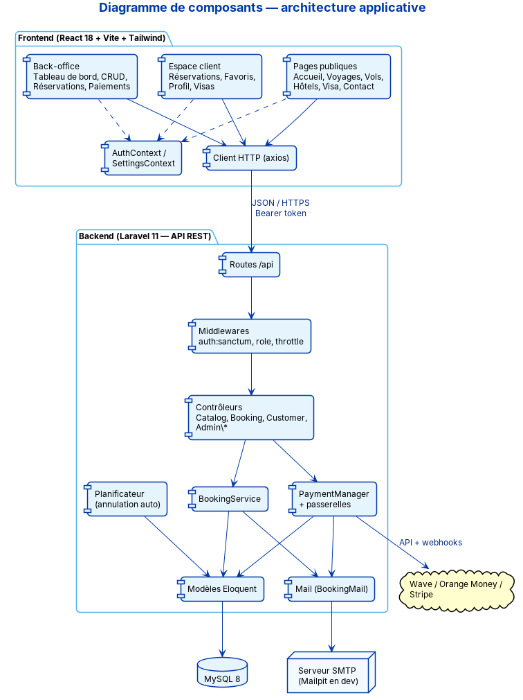
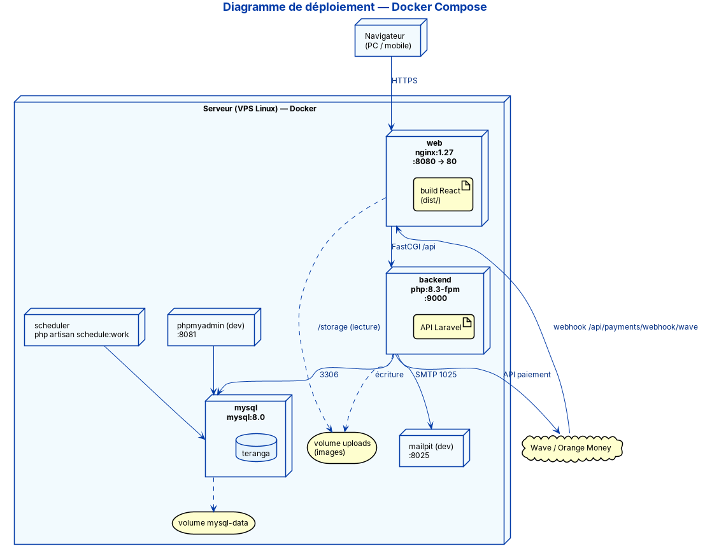
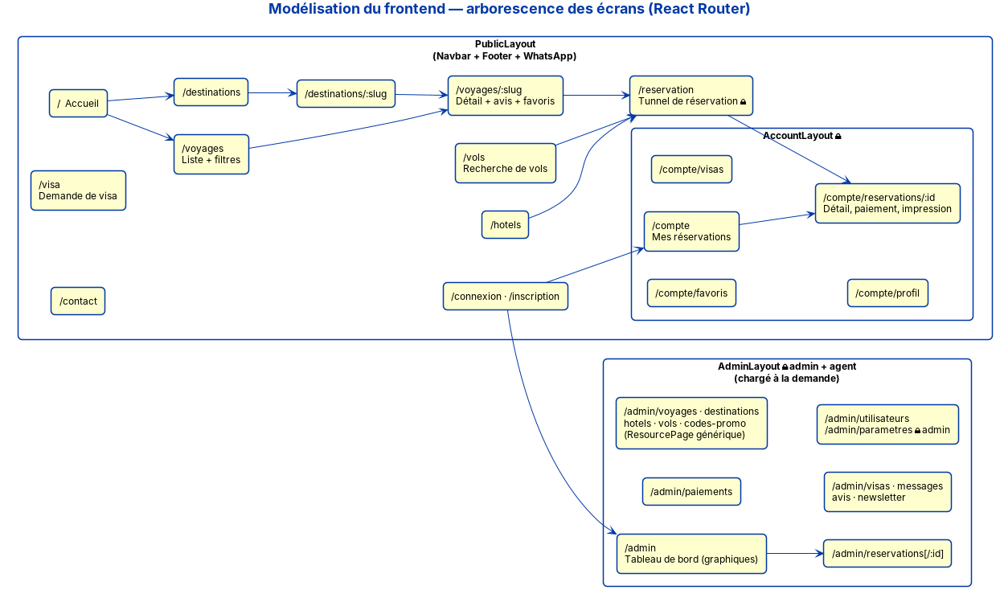

# 1. Présentation du projet

## 1.1 Contexte

Les agences de voyage d'Afrique de l'Ouest vendent encore majoritairement par téléphone, WhatsApp et en agence. Les clients doivent se déplacer pour réserver et payer, et les agents gèrent les dossiers dans des fichiers Excel. **Teranga Voyages** est une application web complète qui permet à une agence de vendre ses voyages en ligne 24h/24, d'encaisser par les moyens de paiement locaux (Wave, Orange Money) et de piloter toute son activité depuis un back-office.

L'application est conçue en **marque blanche** : le nom, les coordonnées, les couleurs et les moyens de paiement se paramètrent sans toucher au code. Elle peut donc être revendue ou louée (modèle SaaS) à d'autres agences.

## 1.2 Identité visuelle

| Élément | Choix |
|---|---|
| Nom | **Teranga Voyages** — « teranga » signifie hospitalité en wolof |
| Slogan | « Voyagez avec l'hospitalité sénégalaise » |
| Couleur principale | Bleu Bic `#0039A6` (variante foncée `#002B7F`) |
| Couleur secondaire | Bleu clair `#4FB3E8`, fond très clair `#E6F4FD` |
| Fond | Blanc `#FFFFFF` |
| Police | Poppins (titres et texte) |
| Logo | Avion en papier blanc traçant une trajectoire au-dessus de vagues bleu clair, dans un cercle bleu Bic (fichiers `branding/`) |

## 1.3 Objectifs

1. Permettre la réservation et le paiement en ligne de voyages organisés, vols et hôtels.
2. Centraliser la gestion des réservations, des paiements et des clients.
3. Réduire les tâches manuelles (devis, factures, relances, annulations automatiques).
4. Offrir des indicateurs de pilotage (chiffre d'affaires, ventes, taux de remplissage).
5. Être déployable en une commande (Docker) et revendable à d'autres agences.

## 1.4 Périmètre

| Inclus (v1) | Exclu (évolutions) |
|---|---|
| Catalogue voyages, destinations, hôtels, vols | Connexion GDS temps réel (Amadeus, Sabre) |
| Réservation, voyageurs, codes promo | Application mobile native |
| Paiement Wave (API), simulation, espèces, virement | Paiement fractionné automatique |
| Espace client, avis, favoris, demandes de visa | Programme de fidélité |
| Back-office complet, statistiques, export CSV | Multi-agences dans une même instance |

# 2. Acteurs

| Acteur | Description | Droits |
|---|---|---|
| **Visiteur** | Internaute non connecté | Consulter, rechercher, demander un visa, contacter, s'inscrire |
| **Client** | Visiteur inscrit | + réserver, payer, annuler, favoris, avis, suivi |
| **Agent** | Employé de l'agence | Back-office : catalogue, réservations, paiements, relation client |
| **Administrateur** | Gérant de l'agence | + gestion des utilisateurs et des paramètres |
| **Prestataire de paiement** | Wave, Orange Money, banque | Système externe : reçoit les paiements, notifie par webhook |

# 3. Besoins fonctionnels

## 3.1 Site public

| Réf. | Fonction | Priorité |
|---|---|---|
| F01 | Page d'accueil : moteur de recherche (voyages, vols, hôtels), voyages à la une, destinations populaires, statistiques, témoignages | Haute |
| F02 | Liste des voyages avec filtres (texte, type, destination, budget, durée, disponibilité) et tris (prix, date, durée, note) | Haute |
| F03 | Fiche voyage : galerie, programme jour par jour, inclus / non inclus, places restantes, avis, voyages similaires, calcul du prix | Haute |
| F04 | Destinations par continent et fiche destination (voyages et hôtels associés) | Moyenne |
| F05 | Recherche de vols (départ, arrivée, date, passagers, classe) | Haute |
| F06 | Recherche d'hôtels (ville, destination, catégorie) | Moyenne |
| F07 | Formulaire de demande de visa avec référence de suivi | Moyenne |
| F08 | Formulaire de contact, newsletter, bouton WhatsApp | Moyenne |
| F09 | Pages À propos et Conditions générales de vente | Basse |

## 3.2 Espace client

| Réf. | Fonction | Priorité |
|---|---|---|
| F10 | Inscription, connexion, déconnexion, modification du profil et du mot de passe | Haute |
| F11 | Tunnel de réservation : voyageurs, dates (hôtel), coordonnées, demandes particulières, code promo, devis en temps réel | Haute |
| F12 | Blocage immédiat des places à la réservation | Haute |
| F13 | Paiement : Wave, Orange Money, carte, virement, espèces en agence | Haute |
| F14 | Historique des réservations, détail, impression du bon / facture (PDF via le navigateur) | Haute |
| F15 | Annulation en ligne d'une réservation non payée (places libérées) | Moyenne |
| F16 | Favoris, dépôt d'avis (modérés), suivi des demandes de visa | Moyenne |
| F17 | E-mails automatiques : réservation enregistrée, paiement reçu, changement de statut, annulation | Haute |

## 3.3 Back-office

| Réf. | Fonction | Priorité |
|---|---|---|
| F20 | Tableau de bord : CA du mois et total, réservations, impayés, clients, graphique CA 12 mois, réservations par statut, top ventes, alertes | Haute |
| F21 | CRUD voyages (programme, galerie, inclus, places, mise en avant), destinations, hôtels, vols | Haute |
| F22 | Téléversement d'images | Moyenne |
| F23 | Gestion des réservations : recherche, filtres, changement de statut, notes internes, export CSV | Haute |
| F24 | Paiements : liste, encaissement en agence, validation des virements | Haute |
| F25 | Codes promo : pourcentage ou montant fixe, minimum d'achat, limite d'utilisations, expiration | Moyenne |
| F26 | Demandes de visa : traitement, statut, note visible par le client | Moyenne |
| F27 | Modération des avis, messages de contact, abonnés newsletter | Moyenne |
| F28 | Utilisateurs et rôles (admin uniquement) | Haute |
| F29 | Paramètres de l'agence en marque blanche (admin uniquement) | Haute |

## 3.4 Règles de gestion

- **RG1** — Une réservation ne peut pas dépasser le nombre de places (voyage, vol) ou de chambres (hôtel) disponibles ; le contrôle est fait dans une transaction avec verrou pour éviter la survente.
- **RG2** — Prix voyage = adultes × prix adulte + enfants × prix enfant. Prix vol enfant = 75 % du tarif adulte. Prix hôtel = chambres × nuits × prix par nuit.
- **RG3** — Un code promo est refusé s'il est inactif, expiré, épuisé ou si le montant minimum n'est pas atteint. La remise ne dépasse jamais le montant.
- **RG4** — Une réservation est créée « en attente de paiement » ; elle passe à « payée » quand la somme des paiements réussis atteint le total.
- **RG5** — Le client ne peut annuler en ligne qu'une réservation en attente ou confirmée ; l'annulation libère les places et restitue le code promo.
- **RG6** — Une réservation non payée depuis 48 h est annulée automatiquement (tâche planifiée horaire).
- **RG7** — Un client ne voit que ses propres réservations ; les agents et administrateurs voient tout.
- **RG8** — Un avis client n'est publié qu'après validation par un agent ; un client a un seul avis par voyage.
- **RG9** — Un administrateur ne peut ni supprimer son propre compte ni retirer ses propres droits.

# 4. Besoins non fonctionnels

| Domaine | Exigence |
|---|---|
| Sécurité | Mots de passe hachés (bcrypt), jetons d'API Sanctum, contrôle des rôles côté serveur, validation de toutes les entrées, limitation de débit (connexion 10/min, formulaires 5/min), protection CSRF non nécessaire (jetons Bearer) |
| Performance | Pages publiques < 2 s en 4G ; back-office chargé à la demande (code splitting) ; pagination de toutes les listes |
| Ergonomie | Responsive mobile en priorité (majorité du trafic au Sénégal sur smartphone), interface 100 % en français |
| Disponibilité | Conteneurs Docker redémarrés automatiquement, sauvegarde quotidienne de la base recommandée |
| Maintenabilité | Code commenté en français, architecture en couches (contrôleurs / services / modèles), tests automatisés |
| Portabilité | Déploiement identique en local et en production via Docker Compose |
| Données personnelles | Conformité à la loi sénégalaise n° 2008-12 (CDP) : finalité limitée, droit de modification et de suppression |

# 5. Architecture technique

| Couche | Technologie |
|---|---|
| Frontend | React 18, Vite 5, React Router 6, Tailwind CSS 3, Axios, Recharts, Lucide |
| Backend | Laravel 11 (PHP 8.3), API REST JSON, Laravel Sanctum, Eloquent ORM |
| Base de données | MySQL 8 (SQLite pour les tests) |
| Serveur web | Nginx (sert le build React et transmet `/api` à PHP-FPM) |
| E-mails | SMTP (Mailpit en développement) |
| Paiement | Wave Checkout API, mode simulation, paiements manuels ; Orange Money et Stripe prévus |
| Conteneurs | Docker Compose : `mysql`, `backend`, `scheduler`, `web`, `phpmyadmin`, `mailpit` |

Les diagrammes UML qui suivent servent de référence pendant tout le développement : toute évolution du code doit être répercutée dans les fichiers `docs/uml/*.puml`.

## 5.1 Diagramme de cas d'utilisation

## 5.2 Diagramme de classes

## 5.3 Modèle logique de données

## 5.4 Séquence — réservation et paiement

## 5.5 Séquence — authentification

## 5.6 Activité — parcours de réservation

## 5.7 États-transitions — réservation

## 5.8 Composants — architecture applicative

## 5.9 Déploiement — Docker

## 5.10 Modélisation du frontend — écrans

# 6. Interface de programmation (API REST)

Préfixe : `/api`. Authentification : en-tête `Authorization: Bearer <jeton>`.

| Méthode | Route | Accès | Rôle |
|---|---|---|---|
| GET | `/settings`, `/home` | Public | Paramètres agence, données d'accueil |
| GET | `/destinations`, `/destinations/{slug}` | Public | Destinations |
| GET | `/packages`, `/packages/{slug}`, `/packages/{slug}/reviews` | Public | Voyages, avis |
| GET | `/hotels`, `/hotels/{slug}`, `/flights`, `/flights/{id}` | Public | Hôtels, vols |
| POST | `/bookings/quote`, `/coupons/check` | Public | Devis, vérification code promo |
| POST | `/contact`, `/newsletter`, `/visa-requests` | Public | Formulaires |
| POST | `/auth/register`, `/auth/login` | Public | Inscription, connexion |
| GET/PUT/POST | `/auth/me`, `/auth/profile`, `/auth/password`, `/auth/logout` | Client | Compte |
| GET/POST | `/bookings`, `/bookings/{id}`, `/bookings/{id}/cancel`, `/bookings/{id}/pay` | Client | Réservations, paiement |
| GET/POST | `/favorites`, `/packages/{slug}/favorite`, `/packages/{slug}/reviews` | Client | Favoris, avis |
| GET | `/my/visa-requests` | Client | Suivi visas |
| POST | `/payments/webhook/{provider}` | Prestataire | Notification de paiement |
| GET | `/admin/dashboard` | Agent | Statistiques |
| CRUD | `/admin/destinations`, `/admin/packages`, `/admin/hotels`, `/admin/flights`, `/admin/coupons` | Agent | Catalogue |
| GET/PUT/POST | `/admin/bookings`, `/admin/bookings/export`, `/admin/bookings/{id}/payments`, `/admin/payments`, `/admin/payments/{id}/confirm` | Agent | Ventes |
| GET/PUT/DELETE | `/admin/reviews`, `/admin/messages`, `/admin/visa-requests`, `/admin/newsletter`, `/admin/uploads` | Agent | Relation client |
| CRUD | `/admin/users`, `/admin/settings` | Admin | Administration |

# 7. Planning prévisionnel

| Phase | Contenu | Durée |
|---|---|---|
| 1. Analyse et conception | Cahier des charges, UML, maquettes | 1 semaine |
| 2. Backend | Base de données, API, règles de gestion, tests | 2 semaines |
| 3. Frontend public et espace client | Pages, tunnel de réservation, paiement | 2 semaines |
| 4. Back-office | Tableau de bord, CRUD, gestion des ventes | 1,5 semaine |
| 5. Paiements réels | Compte Wave Business, tests, webhooks | 1 semaine |
| 6. Recette et mise en ligne | Tests utilisateurs, VPS, nom de domaine, HTTPS | 1 semaine |

# 8. Critères de recette

1. Un visiteur trouve un voyage par filtre et voit son prix total pour N voyageurs.
2. Un client réserve, reçoit un e-mail, paie et voit le statut « Payée ».
3. Il est impossible de réserver plus de places que disponibles, même avec deux clients simultanés.
4. Une réservation annulée libère ses places.
5. Un agent encaisse un paiement en espèces et la réservation passe à « Payée ».
6. Un client ne peut pas accéder au back-office ni aux réservations d'un autre client.
7. L'administrateur change le nom et le téléphone de l'agence et le site les affiche.
8. Les tests automatisés (`php artisan test`) passent.

# 9. Modèle commercial (revente)

- **Licence unique** par agence (installation + personnalisation des couleurs, du logo et des paramètres).
- **Abonnement mensuel SaaS** : hébergement, sauvegardes, mises à jour et support.
- **Options** : intégration Orange Money / carte bancaire, application mobile, connexion GDS, formation des agents.
